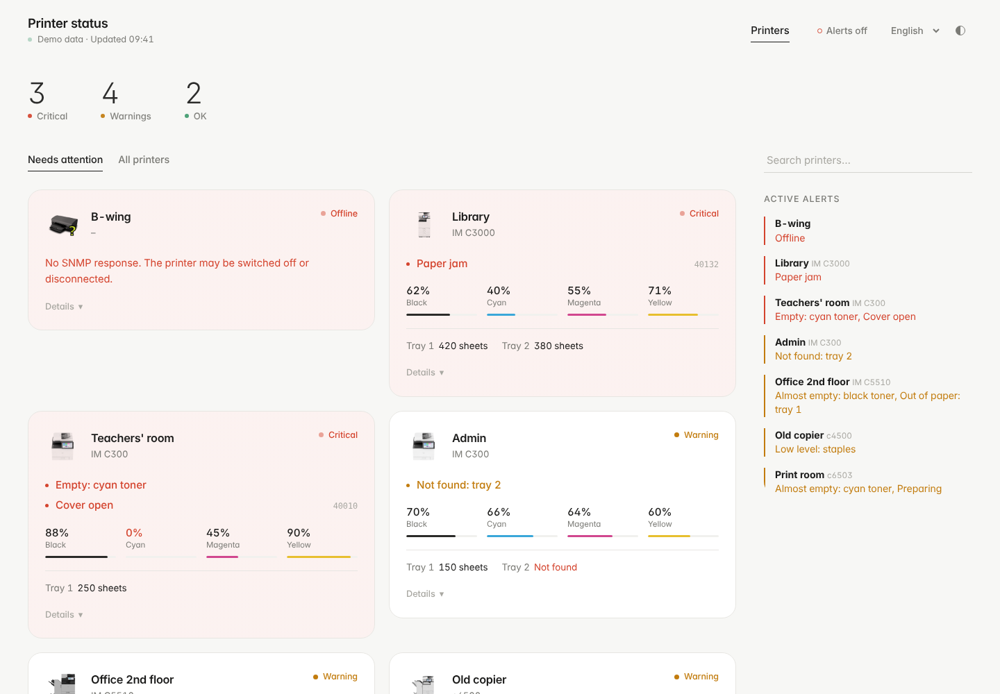
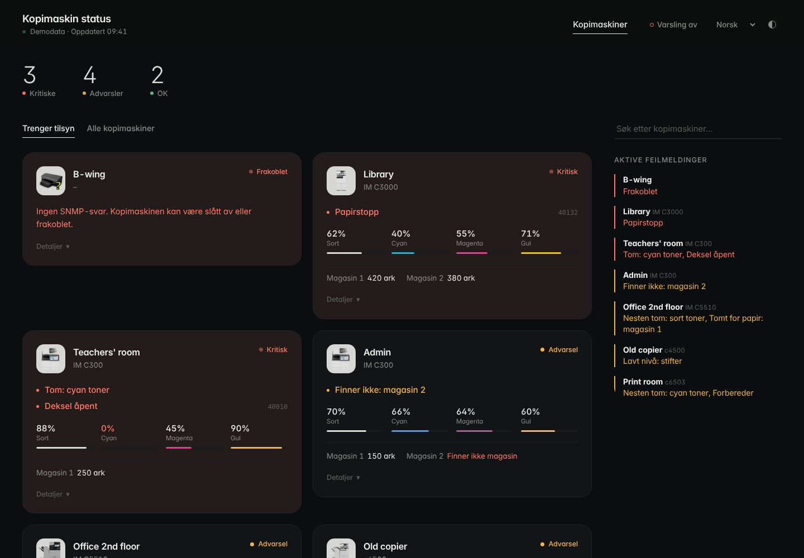
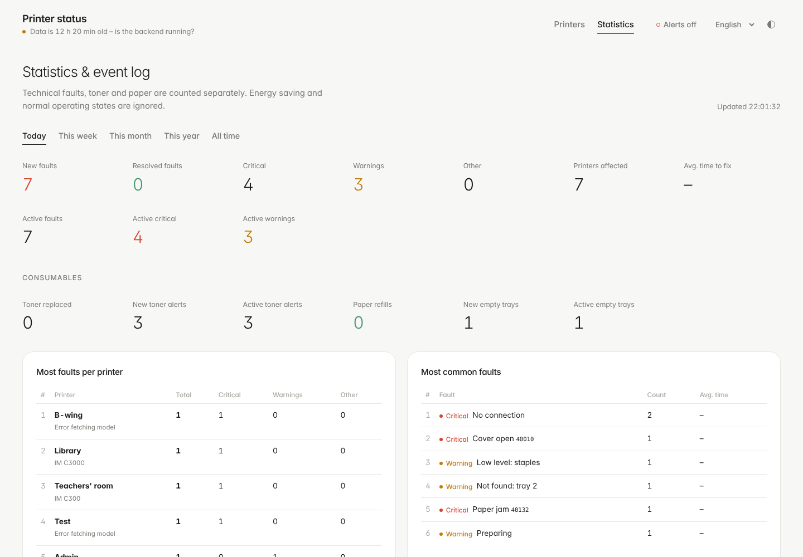

# Resource Monitor Web UI

A calm, minimal status board for your Ricoh (and other Printer-MIB compatible) printers.
A small Python service reads toner, paper and error status over SNMP. The website shows it live,
and an optional PHP + MariaDB part adds history, statistics and service tracking.



| Dark mode (Norsk) | Statistics |
|---|---|
|  |  |

**Live demo:** https://moglestu.com/printstatus/ · try the design locally with `?demo=1`.

## Features

- **Kiosk mode** (`?kiosk=1`): a full-screen view of only the printers with problems, made for a TV.
- **Live dashboard**: toner levels, paper trays and status messages for every printer. It refreshes every few seconds.
- **Languages**: English, Norsk, Svenska and Deutsch. The interface **and the printer messages** are translated, so it does not matter which language the printer panels use. Your choice is remembered (or use `?lang=nb`).
- **Light and dark mode**: follows the system setting, with a toggle in the header.
- **Needs attention / All printers** views, filters, search and a compact *Active alerts* list.
- **Desktop notifications** with sound for *new* critical faults. Press `T` to test the sound.
- **Installable** as an app (PWA).
- **History and statistics** (optional): faults opened/resolved, time to fix, most common faults, toner replacements and paper refills per printer, and an event log by day, week, month or year.
- **Service admin** (optional): mark an active fault as *reported to service*. The printer then gets a yellow service stripe and your note on the public page.
- **Offline and stale detection**: printers that don't answer are shown as offline, and the page warns if the data stops updating.

## How it fits together

```
Printers ──SNMP──► Backend/RicohReader.py ──► printer_data.json ──► website (Frontend/)
                                 │                (local file or SFTP upload)
                                 └──HTTPS──► Frontend/api/process-printers.php ──► MariaDB
                                                                     (history, statistics, service)
```

The live view only needs `printer_data.json`, so the website works on **any static web host**.
History, statistics and the admin page switch on automatically when the PHP API has a database.

---

## Option A – Docker (easiest)

Needs Docker with Compose on a machine that can reach the printers.

```bash
git clone https://github.com/MahanBig/Resource-Monitor-Web-UI.git
```

```bash
cd Resource-Monitor-Web-UI
```

```bash
cp .env.example .env
```

```bash
cp Backend/Printers.example.json Backend/Printers.json
```

Edit `.env` (passwords) and `Backend/Printers.json` (your printers). Then start everything:

```bash
docker compose up -d --build
```

Open `http://<server>:8080`. Database tables are created automatically.

To use the admin page, set `ADMIN_PASSWORD_HASH` in `.env` (see [Admin page](#admin-page)).
If the containers can't reach printers on your LAN, uncomment `network_mode: host` in `docker-compose.yml`.

## Option B – Web host + Raspberry Pi (classic)

### 1. Website

Upload the contents of `Frontend/` to your web host, for example `/www/printstatus/`.

For **history, statistics and the admin page** (needs PHP 8.1+ with PDO MySQL, and MariaDB/MySQL):

1. Create an empty database.
2. Copy `api/config.example.php` to `api/config.php` and fill in the database settings and a `logger_key`:
   ```bash
   python3 -c "import secrets; print(secrets.token_urlsafe(48))"
   ```
3. Open `https://example.com/printstatus/api/health.php`. It creates the tables and should answer `"ok": true`.

Without `api/config.php` the site still works. Statistics and admin are simply hidden.

### 2. Backend (Raspberry Pi, Linux or Windows)

Python 3.9+ on a machine that can reach the printers:

```bash
cd Backend
```

```bash
python3 -m venv .venv && . .venv/bin/activate && pip install -r requirements.txt
```

```bash
cp config.example.json config.json
```

Edit `config.json`:

| Setting | Meaning |
|---|---|
| `interval_seconds` | How often to poll (default 40). |
| `snmp.community` | SNMP community (default `public`). |
| `output.file` | Where `printer_data.json` is written. Point it into the web folder if the website runs on the same machine. |
| `sftp.*` | Upload to a web host. Remove the `host` to disable. `key_file` and `verify_host_key` are supported. |
| `logger.url` / `logger.key` | Full URL of `api/process-printers.php` and the same `logger_key` as in `api/config.php`. Leave empty to skip history. |

An existing `credentials.json` from older versions still works. Every setting can also be set with
an environment variable (`RM_SFTP_HOST`, `RM_LOGGER_KEY`, … see the top of `RicohReader.py`).

Add printers, then test:

```bash
python RicohReader.py printers add --ip 192.0.2.20 --name "Library"
```

```bash
python RicohReader.py once
```

Run it permanently with systemd (instructions inside the file):

```bash
sudo cp ../deploy/resource-monitor.service /etc/systemd/system/
```

Other commands: `printers list`, `printers remove <ip|name>`, `printers edit`, `printers import-pkl Printers.pkl`, `check`.

### Printer images

Put a PNG in `Frontend/images/` named after the model with spaces replaced by `-`.
For example, model `IM C3000` uses `IM-C3000.png`. Unknown models show `missing.png`.

## Website settings – `Frontend/config.json`

| Key | Default | |
|---|---|---|
| `title` | *(translated "Printer status")* | Page title. |
| `logo` | – | Path to a logo shown in the header. |
| `pollSeconds` | `8` | How often the page reloads data. |
| `staleAfterMinutes` | `5` | Warn when the data is older than this. |
| `lowPaperSheets` | `55` | A tray below this is shown as low. |
| `defaultLanguage` | `auto` | `auto`, `en`, `nb`, `sv` or `de`. |
| `defaultView` | `attention` | `attention` or `all`. |
| `dataUrl`, `apiUrl` | | Change only if files live elsewhere. |

### URL flags

| Flag | Effect |
|---|---|
| `?lang=nb` | Language (`en`, `nb`, `sv`, `de`). |
| `?stats=1` | Open the statistics view. |
| `?kiosk=1` | **Kiosk mode for a TV or wall screen:** only the printers that need attention, as large cards filling the screen. No menus, buttons or mouse cursor. If there are more cards than fit, the page scrolls slowly through them. When everything is fine it shows a big "All printers are working". A small corner note shows the last update time and turns orange or red if data stops arriving. Combine with `&lang=nb`, `&darkmode=1` or `&ignoreconsumables=1`. |
| `?view=all` / `?view=summary` | All printers / only a compact text list of alerts. |
| `?darkmode=1` | Force dark mode. `?darkseason=1` uses dark mode in November to January. |
| `?ignoreconsumables=1` | Hide *low* toner and empty trays on this screen. Empty toner and real faults are still shown, and everything is still logged. |
| `?demo=1` | Show built-in demo data. |

## Error classification

`Frontend/error_rules.json` decides which messages are ignored (energy saver…), technical
**critical**/**warning** faults, or **toner**/**paper** consumables. The website and the history
logger share it. Each group can match by `codes`, `starts`, `contains` or `exact` text.
Empty toner (`Tom:` / `Empty:`) is shown red but logged as toner, so replacements are counted.

To translate a new printer message, add it to `Frontend/js/printer-messages.js`.

## Admin page

`/admin/` lets you mark active technical faults as *reported to service*.

1. Create a password hash:
   ```bash
   python3 tools/hash-password.py
   ```
2. Copy `admin/config.example.php` to `admin/config.php` and paste the hash. With Docker, put it in `.env` and write each `$` as `$$`.

Includes CSRF protection, secure session cookies, login rate limiting and strict security headers.
Service notes are **public**, so don't write names or phone numbers in them.

## Adding a language

1. Copy `Frontend/js/locales/en.js` to e.g. `fr.js` and translate it.
2. Register it in `LANGUAGES` in `Frontend/js/i18n.js`.
3. Add the language to the phrases in `Frontend/js/printer-messages.js`, and (optionally) to `Frontend/admin/lang.php`.

## Upgrading

- **From the old version of this repo:** replace the files. `Printers.json` and `credentials.json` keep working. Run `pip install -r requirements.txt` again, because the backend now uses puresnmp 2 and no longer needs Tkinter or Pmw.
- **From Kopimaskin-SNMP-nettvisning:** keep `api/config.php`, `admin/config.php` and the database. Missing columns are added automatically on the first request. Convert the printer list with `python RicohReader.py printers import-pkl Printers.pkl`. Existing admin configs with `password => [iterations, salt, hash]` still work.

## Development

```bash
python -m unittest discover -s Backend/tests
```

```bash
node --test tests/*.test.mjs
```

```bash
php tests/classification.test.php
```

Run the site locally with `php -S localhost:8000 -t Frontend` and open `http://localhost:8000/?demo=1`.

## Security

What is in place (and tested in CI / by hand against a live install):

- **No XSS:** every value from printers, the database or config is HTML-escaped. A strict
  Content-Security-Policy forbids inline and third-party scripts, so even a missed spot couldn't run code.
- **No SQL injection:** all queries use bound parameters, and the only interpolated values are
  whitelisted constants or integers.
- **Logger endpoint:** needs the secret `X-Logger-Key` (constant-time compare, minimum 16 characters).
  POST only, 5 MB body limit, at most 1000 printers per snapshot, and every value is type-checked
  and cut to the database column size.
- **Admin:** PBKDF2 (600 000 rounds) or bcrypt/argon2 passwords and CSRF tokens on every form.
  Session cookies are HttpOnly, SameSite=Strict and Secure on HTTPS, with strict session mode and a new ID at login.
  After 5 failed logins the IP is locked out for 15 minutes, and response time doesn't reveal whether a
  username exists. Clickjacking protection and HSTS are on.
- **API:** error messages never leak internals. `health.php` shows details only with the logger key.
  `config.php`, `bootstrap.php` and hidden files are blocked by `.htaccess`.
- **Backend:** SFTP server keys are pinned on first use (`Backend/known_hosts`), so a changed key
  (possible man-in-the-middle) stops the upload. It warns if the logger key would be sent over plain
  `http://` or if `config.json` is readable by other users. Legacy `.pkl` files are imported with a
  restricted unpickler that can't run code.
- **Docker:** the database is not exposed, the poller runs as a non-root, read-only container with no
  capabilities, `no-new-privileges` is set everywhere, and PHP/Apache version banners are hidden.
- **Dependabot** opens a pull request when a dependency gets a security fix.

Things only you can do:

- Serve the site over **HTTPS**, especially `/admin/` and the logger URL.
- Use long random values for `LOGGER_KEY` and the database password, and a strong admin password.
- `chmod 600 Backend/config.json` and keep `.env` / `config.php` out of git (already in `.gitignore`).
- Remember that service notes and printer names/IPs are visible to anyone who can open the page.
  Put the site behind your network or a login if that matters.
- If you are behind a reverse proxy, all visitors share one IP for the login lockout, so an attacker
  can lock the admin out for 15 minutes (but still can't guess the password).

Found a problem? Please open a GitHub issue (or contact the maintainer privately for anything sensitive).

## Don't commit

`.env`, `Backend/config.json`, `Backend/credentials.json`, `Frontend/api/config.php`,
`Frontend/admin/config.php` and `printer_data.json` (all already in `.gitignore`).

## Credits

- [@mahanbig](https://www.github.com/mahanbig): Resource Monitor Web UI.
- [zhyl0/Kopimaskin-SNMP-nettvisning](https://github.com/zhyl0/Kopimaskin-SNMP-nettvisning): history, statistics, service admin, notifications and PWA features merged into this version.
- Based on [Ricoh Resource Monitor](https://github.com/4rm/Ricoh-Resource-Monitor) by Emilio Garcia (MIT, see `LICENSE`).
